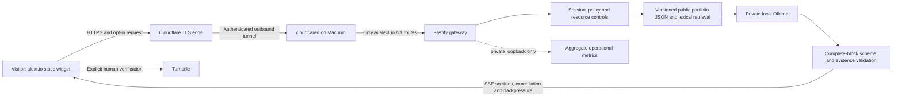

# Architecture decision record

Status: application implementation tested with fixtures; production runtime choice and external activation pending actual Mac evidence.

## Existing environment

Inspected public repository base `18ee50adfa63008b9727d39842cf5a674d1924ea`. The website is a single static `index.html` with inline CSS and JavaScript. The existing manual Namecheap workflow uploads only that file with strict SSH host checking, a SHA-256 check, backup and atomic replacement. It targets `/home/realtorstudio/alext.io`. A successful prior website deployment was observed in run `38328359388`; it was not an AI deployment.

Repository writes and hosted Actions are available. The implementation environment is a separate Linux sandbox, not the Mac mini. No Mac, router, Cloudflare, authoritative DNS or Namecheap control-panel access has been established. The Mac model, chip, RAM, free disk, Docker configuration, active services and selected Ollama model therefore remain unknown.

## Smallest suitable topology

Cloudflare terminates browser TLS. The tunnel encrypts the edge-to-connector leg. The gateway-to-model leg is a private container network or approved host loopback, not browser-to-Ollama end-to-end encryption.

## Decisions

**No frontend framework migration.** The widget uses standard DOM APIs, an isolated stylesheet and a native dialog. A release builder inserts the widget without changing existing homepage bytes. This respects the existing single-file hosting model and avoids introducing a frontend dependency bundle.

**One gateway and one local model runtime.** Session state, quotas, retrieval and aggregate metrics are small bounded in-process structures. A process restart drops sessions and resets quotas, which is acceptable for a portfolio service. A global hourly generation budget limits distributed session abuse. A database would add operational cost without a demonstrated benefit.

**Evidence selection rather than free-form resume generation.** Personal experience paragraphs are selected by approved fact IDs and reconstructed on the server. An LLM cannot change those paragraphs or introduce an invented personal claim through an evidence block. A source can still be self-reported rather than employer-verified; provenance is explicit.

**Validated section streaming, not raw model tokens.** Local model output is parsed incrementally, but only complete validated blocks are sent to the browser. This adds time before the first visible text and is intentional. Sending unvalidated tokens would let a later validator discover a fabricated claim only after the visitor had already seen it. Both raw model TTFT and first validated block latency are measured separately.

**Bearer sessions, not cookies.** A verified visitor receives a random 256-bit token kept only in tab memory. The token is bound to the source IP group and exact Origin, expires after 15 minutes, and cannot control model settings. Cross-site cookie CSRF does not apply because cookies are not used; the required custom Authorization header, Origin checks and human verification remain independent controls. An IP change intentionally requires re-verification.

**Fail closed.** Missing model, wrong digest, malformed classifier output, unknown evidence, disallowed advice, expired session, queue overflow or invalid verification fails without fallback to a commercial model. Static GitHub/contact links remain usable.

## Runtime decision remains open

The baseline Compose configuration keeps Ollama inside an internal Docker network with no published ports. On Apple Silicon, Docker Desktop lacks GPU passthrough for Ollama, according to the official FAQ. A container benchmark is required before retaining this design.

If CPU inference fails the agreed latency and host-resource targets, compare native macOS Ollama with Metal. This requires explicit owner approval. Native Ollama must stay on `127.0.0.1:11434`. Do not change it to `0.0.0.0` to solve a container connection problem.

Test container-to-loopback reachability on the actual Docker Desktop configuration. `host.docker.internal` is not assumed to work with a loopback-only listener. If it does not, the next proposal is a fully loopback native gateway/connector managed by launchd, or another separately reviewed local transport. Do not silently enable Docker host networking or bind Ollama to the LAN. The supplied native configuration switch is a guarded application option, not proof that native service installation or networking has been performed.

## Non-goals

No general-purpose assistant, arbitrary coding service, model tools, shell execution, scraping user-supplied URLs, visitor uploads, automatic calendar booking, private repository ingestion or confidential employer knowledge. No Kubernetes, Redis, database or public administrative dashboard.

## References checked during implementation

- https://docs.ollama.com/faq
- https://docs.ollama.com/api/chat
- https://developers.cloudflare.com/turnstile/get-started/server-side-validation/
- https://developers.cloudflare.com/dns/zone-setups/partial-setup/
